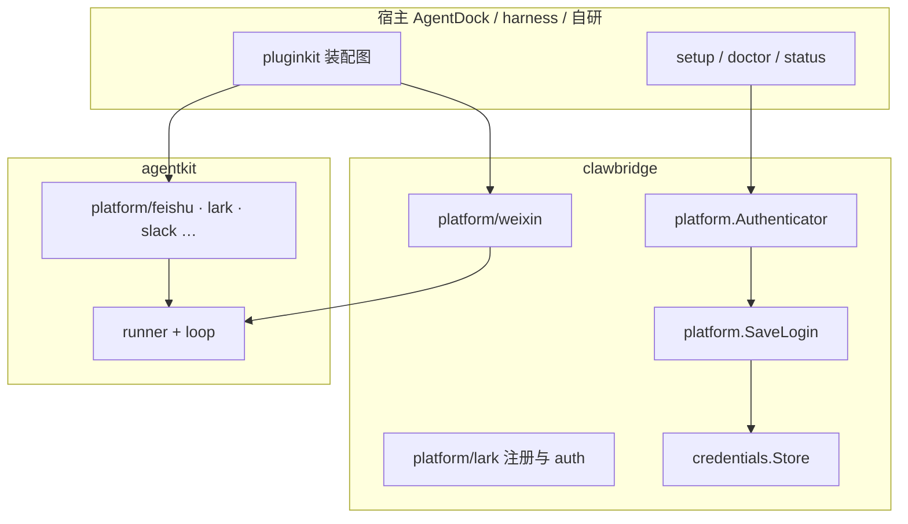

# clawbridge：AgentKit Platform 扩展

clawbridge **只做 AgentKit 的 platform 层**：可插拔的 `agentkit.Platform` 实现，以及各 IM 在 setup 阶段的**登录/注册**边界。不包含 Bus、Driver Manager、媒体缓冲等独立 IM 桥接栈。

## 职责划分



| 包 | 职责 |
|----|------|
| `platform` | `Authenticator`、`LoginRequest` / `LoginResult`、`SaveLogin` — 各平台登录插件的统一契约 |
| `credentials` | 凭据槽 `Store`（keyring / memory），供 `SaveLogin` 与宿主解析 `keyring://` 引用 |
| `platform/lark` | Lark/飞书官方扫码建应用 + `platform/auth-lark` / `platform/auth-feishu` |
| `platform/weixin` | 微信 iLink 长轮询，`platform/weixin` 完整 `agentkit.Platform` |
| `platform/cloudweb` | cc-connect **Cloud Web** 协议 → `agentkit.Platform`（桥接其余 IM） |
| `platform/catalog` | 平台清单与推荐装配策略（对齐 cc-connect UI） |
| `plugin` | 注册 `clawbridge/credentials-*` 等 clawbridge 自有 kind |

**消息通道**：Lark/飞书/Slack 用 agentkit 内置 `platform/*`。微信用 `platform/weixin`。**Telegram、Discord、钉钉、企业微信等**不逐个在 clawbridge 重写：由 cc-connect（或兼容网关）跑原生 driver，AgentKit 侧挂 **`platform/cloud-web`**，只处理 JSON 线协议（见下节）。

## 插件化约定

与 [AgentDock platform](../AgentDock/docs/architecture.md) 对齐：

1. **运行插件**（`agentkit.Platform`）：在各自包的 `init` 中 `pluginkit.Register("platform/<kind>", New)`。
2. **登录插件**（`platform.Authenticator`）：`pluginkit.Register("platform/auth-<kind>", …)`，由宿主 CLI 按 kind 构造，不扩展 switch。
3. **凭据**：`Authenticator.Login` 只返回 `LoginResult`；`platform.SaveLogin` 统一写 Store、回读校验、生成 `keyring://` 引用。
4. **命名空间**：clawbridge 自有装配 kind 使用 `clawbridge/` 前缀，避免与 agentkit 的 `platform/*`、`agent/*` 冲突。

## 装配示例

```yaml
# 微信 + 飞书（微信用 clawbridge，飞书用 agentkit）
platform.gateway:
  use: platform/multiplex
  deps:
    platforms:
      - platform.feishu
      - platform.weixin

platform.feishu:
  use: platform/feishu
  config:
    appId: "cli_xxx"
    appSecret: "..."  # 或由图注入

platform.weixin:
  use: platform/weixin
  config:
    botId: "..."
    token: "..."
  deps:
    inboundPolicy: policy.owner
```

宿主进程需 blank import：

```go
import (
    _ "github.com/lengzhao/agentkit/plugins"
    _ "github.com/lengzhao/clawbridge"           // weixin + lark auth
    _ "github.com/lengzhao/clawbridge/plugin"   // credentials slots
)
```

## cc-connect 平台与桥接策略

`platform/catalog` 与 [cc-connect `platformMeta`](https://github.com/chenhg5/cc-connect) 对齐，三类装配：

| 策略 | 示例 | pluginkit `use` |
|------|------|-----------------|
| agentkit 原生 | feishu, lark, slack | `platform/feishu` 等（agentkit/plugins） |
| clawbridge 原生 | weixin, cloud_web | `platform/weixin`, `platform/cloud-web` |
| Cloud Web 桥接 | telegram, discord, dingtalk, wecom, qq, qqbot, line, weibo, matrix, webex, max, yuanbao | `platform/cloud-web` + `config.bridgeName` |

桥接拓扑：

```mermaid
sequenceDiagram
  participant IM as 各 IM API
  participant CC as cc-connect driver
  participant GW as Cloud Web 网关
  participant CB as clawbridge cloud-web
  participant AK as AgentKit runner
  IM --> CC
  CC --> GW
  GW -->> CB: WebSocket / long_poll JSON
  CB -->> AK: MessageEvent
  AK -->> CB: OutboundEvent
  CB -->> GW: reply JSON
  GW -->> CC: 下发
  CC --> IM
```

查询清单：`catalog.ByID("telegram")` → `StrategyBridge`、`BridgeName: "telegram"`。

## 新增平台 checklist

1. 若 cc-connect 已有 driver：优先 **桥接**——在 `platform/catalog` 登记 `StrategyBridge`，无需新 Go driver。
2. 否则在 `platform/<name>/` 实现完整 `agentkit.Platform`。
3. 实现 `platform.Authenticator` 并注册 `platform/auth-<name>`。
3. 凭证 role 使用 `id` / `secret`（及平台特有 role，如 weixin 的 `owner`）。
4. 补充 `*_test.go`；更新本文与 README。
