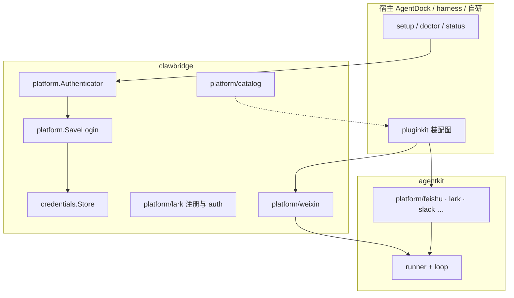

# clawbridge：AgentKit Platform 扩展

clawbridge **只做 AgentKit 的 platform 层**：可插拔的 `agentkit.Platform` 实现，以及各 IM 在 setup 阶段的**登录/注册**边界。不包含 Bus、独立网关线协议或中间 JSON 桥。

## 职责划分



| 包 | 职责 |
|----|------|
| `platform` | `Authenticator`、`LoginRequest` / `LoginResult`、`SaveLogin` |
| `credentials` | 凭据槽 `Store`（keyring / memory） |
| `platform/lark` | Lark/飞书扫码建应用 + auth 插件 |
| `platform/weixin` | 微信 iLink，`platform/weixin` |
| `platform/catalog` | 平台 id 清单：已装配 vs planned |
| `plugin` | `clawbridge/credentials-*` |

**消息通道**：飞书/Lark/Slack → agentkit 内置；微信 → clawbridge。**其它 IM** 不在此仓库走中间协议，按计划在 `platform/<id>/` 直接实现 `agentkit.Platform`（可参考 cc-connect 同平台 driver 的协议逻辑，代码落在本仓库，不 `import` cc-connect）。

## 插件化约定

与 [AgentDock platform](../AgentDock/docs/architecture.md) 对齐：

1. **运行插件**：`pluginkit.Register("platform/<kind>", New)` → `agentkit.Platform`
2. **登录插件**：`pluginkit.Register("platform/auth-<kind>", …)` → `platform.Authenticator`
3. **凭据**：`SaveLogin` + `keyring://` 引用
4. **命名**：clawbridge 自有 kind 用 `clawbridge/` 前缀

## 装配示例

```yaml
platform.gateway:
  use: platform/multiplex
  deps:
    platforms:
      - platform.feishu
      - platform.weixin

platform.feishu:
  use: platform/feishu
  config:
    appId: "cli_xxx"
    appSecret: "..."

platform.weixin:
  use: platform/weixin
  config:
    botId: "..."
    token: "..."
  deps:
    inboundPolicy: policy.owner
```

```go
import (
    _ "github.com/lengzhao/agentkit/plugins"
    _ "github.com/lengzhao/clawbridge"
    _ "github.com/lengzhao/clawbridge/plugin"
)
```

## 平台清单（catalog）

| 策略 | 说明 | 示例 |
|------|------|------|
| `agentkit` | 内置插件 | feishu, lark, slack |
| `clawbridge` | 本仓库已实现 | weixin |
| `planned` | 待在本仓库或 agentkit 新增原生 `platform/*` | telegram, discord, dingtalk, … |

`catalog.Implemented()` 仅返回前两类中已有 `PluginKind` 的条目。  
新增平台：**在 `platform/<name>/` 实现 Platform + 可选 Authenticator**，更新 catalog，**不**引入 Cloud Web / Bridge 类线协议依赖。

## 新增平台 checklist

1. 在 `platform/<name>/` 实现 `agentkit.Platform`（Receive/Send，复用 agentkit `runtime/platform/common`）。
2. 实现 `platform.Authenticator` 并注册 `platform/auth-<name>`。
3. 在 `platform/catalog` 将 `StrategyPlanned` 改为 `StrategyClawbridge` 并填写 `PluginKind`。
4. 补充测试；更新本文与 README。
